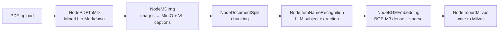
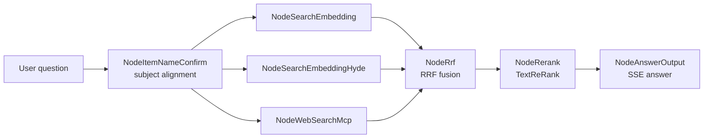

# zRAG

> A retrieval-augmented generation workbench: from PDF to cited answers

**English** · [简体中文](./README.md)

zRAG is an end-to-end knowledge base QA workbench. Upload a PDF and the system parses, chunks, embeds and indexes it automatically. When a question arrives, hybrid retrieval and reranking gather the evidence, and an SSE stream delivers the answer with source citations. The frontend, REST API, ingestion pipeline and query pipeline all run inside a single FastAPI process.

---

## Features

- **Hybrid retrieval**: BGE-M3 produces both dense (COSINE) and sparse (IP) vectors, fused by Milvus `WeightedRanker`
- **Multi-route recall**: plain vector search + HyDE hypothetical-document search + WebSearch MCP, merged with Reciprocal Rank Fusion (RRF)
- **Reranking**: DashScope `TextReRank` (`qwen3.7-text-rerank`) with a cliff-based dynamic `top_n`
- **Subject recognition**: an LLM summarises each document's subject and stamps every chunk with it; queries are aligned to that subject before retrieval and filtered by it
- **LangGraph orchestration**: ingestion and querying are separate state machines, with per-node progress streamed to the frontend over SSE
- **Document processing**: MinerU converts PDFs to Markdown; images are stored in MinIO and given Chinese captions by a VL model
- **Conversational**: MongoDB-backed history, multi-window workspace and follow-up clarification
- **Try it instantly**: built-in demo knowledge bases need no Milvus or MinerU — configure only the LLM to exercise the full QA flow

---

## Architecture

### Ingestion pipeline



### Query pipeline



---

## Tech stack

| Layer | Choice |
| --- | --- |
| Web | FastAPI, Uvicorn, SSE |
| Orchestration | LangGraph, LangChain, `openai-agents` |
| Vector store | Milvus (dense + sparse hybrid search) |
| Embedding | BGE-M3 (`pymilvus[model].BGEM3EmbeddingFunction`, CPU by default) |
| LLM / Rerank | DashScope OpenAI-compatible API, `qwen-plus` / `qwen-vl-max` / TextReRank |
| PDF parsing | MinerU cloud API |
| Object storage | MinIO (document images) |
| Session storage | MongoDB |
| Web search | DashScope WebSearch MCP |
| Tooling | uv, Python ≥ 3.12 |

---

## Getting started

### 1. Prerequisites

- Python ≥ 3.12 and [uv](https://docs.astral.sh/uv/)
- Milvus (default `19530`), MinIO (default `9000/9001`) and MongoDB (default `27017`) — local Docker containers or existing services
- Local BGE-M3 model weights (~2 GB)
- A DashScope / OpenAI-compatible API key and a MinerU token

### 2. Install dependencies

```bash
git clone https://github.com/Faker23231/zRAG.git
cd zRAG
uv sync
```

### 3. Download BGE-M3

```bash
MODEL_LOCAL_DIR=/home/ubuntu/ai_models/bge-m3 uv run python zzk/tool/download_bgem3.py
```

Set `BGE_M3_PATH` in `.env` to the resulting directory.

### 4. Create `.env`

`.env` lives in the project root and is loaded by absolute path from `zzk/config/config.py`. It is excluded by `.gitignore` and never committed. Create it with:

```dotenv
# Web server
API_HOST=0.0.0.0
API_PORT=8000
API_RELOAD=false
RAG_DATA_DIR=/path/to/zRAG/data

# LLM (OpenAI-compatible endpoint)
OPENAI_API_KEY=sk-replace-me
OPENAI_API_BASE=https://dashscope.aliyuncs.com/compatible-mode/v1
LLM_DEFAULT_MODEL=qwen-plus
LLM_DEFAULT_TEMPERATURE=0.3
VL_MODEL=qwen-vl-max
ITEM_MODEL=qwen-plus

# MinerU (PDF → Markdown)
MINERU_TOKEN=replace-with-your-mineru-token

# MinIO
MINIO_ENDPOINT=127.0.0.1:9000
MINIO_ACCESS_KEY=replace-me
MINIO_SECRET_KEY=replace-me
MINIO_BUCKET_NAME=kb-bucket
MINIO_IMG_DIR=kb-img

# Milvus
MILVUS_URL=http://127.0.0.1:19530
CHUNKS_COLLECTION=zzk_chunks
ITEM_NAME_COLLECTION=zzk_item_names

# MongoDB
MONGO_URL=mongodb://127.0.0.1:27017
MONGO_HOST=127.0.0.1
MONGO_PORT=27017
MONGO_DB_NAME=zzk_rag

# Local BGE-M3 model
BGE_M3_PATH=/home/ubuntu/ai_models/bge-m3
BGE_DEVICE=cpu
BGE_FP16=False

# Reranking
RERANK_BASE_URL=https://dashscope.aliyuncs.com
RERANK_API_KEY=sk-replace-me

# WebSearch MCP
MCP_BASE_URL=https://dashscope.aliyuncs.com/api/v1/mcps/WebSearch/mcp
MCP_API_KEY=sk-replace-me
```

> `LLM_DEFAULT_TEMPERATURE` and `MONGO_PORT` are cast directly with `float()` / `int()` and have no defaults, so omitting them breaks startup. All other keys must be present as well.

### 5. Run

```bash
uv run zrag
# or
uv run uvicorn zzk.web.app:app --host 0.0.0.0 --port 8000
```

Open <http://localhost:8000> for the workbench, <http://localhost:8000/docs> for the OpenAPI docs, and `GET /api/health` to check Milvus / MinIO / MongoDB connectivity.

---

## Configuration

| Group | Variables | Purpose |
| --- | --- | --- |
| Web | `API_HOST` / `API_PORT` / `API_RELOAD` | Bind address, port, hot reload |
| Web | `RAG_DATA_DIR` | Directory for uploads and the project registry |
| LLM | `OPENAI_API_KEY` / `OPENAI_API_BASE` | OpenAI-compatible key and base URL |
| LLM | `LLM_DEFAULT_MODEL` / `LLM_DEFAULT_TEMPERATURE` | Default chat model and temperature |
| LLM | `VL_MODEL` / `ITEM_MODEL` | Image understanding / subject extraction model |
| Parsing | `MINERU_TOKEN` | MinerU cloud API token |
| Storage | `MINIO_*` | MinIO endpoint, credentials, bucket and image prefix |
| Storage | `MILVUS_URL` / `CHUNKS_COLLECTION` / `ITEM_NAME_COLLECTION` | Milvus endpoint and the two collections |
| Storage | `MONGO_*` | MongoDB connection details and database name |
| Model | `BGE_M3_PATH` / `BGE_DEVICE` / `BGE_FP16` | Local BGE-M3 path, device, FP16 flag |
| Rerank | `RERANK_BASE_URL` / `RERANK_API_KEY` | DashScope TextReRank endpoint and key |
| Web search | `MCP_BASE_URL` / `MCP_API_KEY` | WebSearch MCP endpoint and key |

---

## API

| Method | Path | Description |
| --- | --- | --- |
| `GET` | `/` | Workbench frontend |
| `GET` | `/api/health` | Health check (Milvus / MinIO / Mongo / LLM / demo count) |
| `GET` | `/api/examples` | Built-in demo projects |
| `POST` | `/api/clarify` | Heuristic clarification for vague questions (demo projects only) |
| `GET` | `/api/projects` | List projects |
| `POST` | `/api/projects` | Create a project from a PDF (multipart field `file`, ≤ 50 MB) |
| `GET` | `/api/projects/{id}/status` | Ingestion progress snapshot |
| `DELETE` | `/api/projects/{id}` | Delete a project |
| `POST` | `/api/chat` | Create a chat task, returns `task_id` |
| `GET` | `/api/stream/{task_id}` | SSE stream (node progress + answer) |
| `GET` | `/api/history/{session_id}` | Conversation history |
| `DELETE` | `/api/history/{session_id}` | Clear conversation history |
| `GET` | `/docs` | Auto-generated OpenAPI docs |

Typical flow: `POST /api/projects` to upload → poll `GET /api/projects/{id}/status` until ingestion finishes → `POST /api/chat` for a `task_id` → open an SSE connection to `GET /api/stream/{task_id}` to receive the answer.

---

## Project layout

```text
zRAG/
├── zzk/
│   ├── config/              # Config classes and prompts
│   ├── import_process/      # Ingestion pipeline (LangGraph state machine + nodes)
│   ├── query_process/       # Query pipeline (LangGraph state machine + nodes)
│   ├── tool/                # Milvus / MinIO / Mongo / BGE-M3 / Rerank clients
│   └── web/
│       ├── app.py           # FastAPI entry point and routes
│       ├── pages/           # Static frontend assets
│       ├── service/         # Project / chat / history / demo services
│       └── data/            # Built-in demo data
├── src/kb_0716/             # Compatibility shim, now delegates to zzk.web.app
├── test/                    # Python / FastAPI learning exercises, not used in production
├── pyproject.toml
├── uv.lock
└── .env                     # Local config (gitignored)
```

---

## Notes

- Every key/token in `.env` is a placeholder — replace them before running, and never commit the file to a public repository.
- PDF uploads are limited to 50 MB; only PDF is supported.
- BGE-M3 runs on CPU by default, so the first ingestion has a cold-start cost. Adjust `BGE_DEVICE` and `BGE_FP16` when a GPU is available.
- Built-in demo projects cannot be deleted; demo retrieval uses lightweight Chinese token matching instead of Milvus.
- `test/` contains learning exercises and is unrelated to the application.
