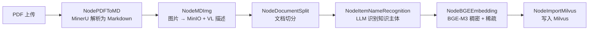
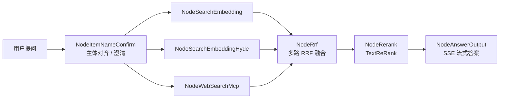

# zRAG

> 从 PDF 到带引用答案的检索增强生成（RAG）工作台

[English](./README.en.md) · **简体中文**

zRAG 是一个端到端的知识库问答工作台：上传 PDF，系统自动完成解析、切分、向量化入库；提问时通过混合检索与重排序召回证据，再以 SSE 流式生成带来源引用的答案。前端页面、REST API、导入流水线、查询流水线运行在同一个 FastAPI 进程中。

---

## 核心特性

- **混合检索**：BGE-M3 同时产出稠密向量（COSINE）与稀疏向量（IP），由 Milvus `WeightedRanker` 加权融合
- **多路召回**：普通向量检索 + HyDE 假设性文档检索 + WebSearch MCP 联网检索，结果经 RRF 融合
- **重排序**：DashScope `TextReRank`（`qwen3.7-text-rerank`），带断崖式动态 `top_n`
- **知识主体识别**：LLM 归纳文档主题并回填到每个切片，查询前先做主体名称对齐，再用其过滤召回范围
- **LangGraph 编排**：导入与查询各是一条状态机，节点执行进度通过 SSE 实时推送到前端
- **文档处理**：MinerU 解析 PDF，图片上传 MinIO 并生成中文图像描述
- **会话能力**：MongoDB 保存历史，支持多窗口工作台与追问澄清
- **开箱体验**：内置示例知识库不依赖 Milvus / MinerU，只配好 LLM 即可体验完整问答流程

---

## 架构

### 导入流水线



### 查询流水线



---

## 技术栈

| 层次 | 选型 |
| --- | --- |
| Web | FastAPI、Uvicorn、SSE |
| 编排 | LangGraph、LangChain、`openai-agents` |
| 向量库 | Milvus（dense + sparse 混合检索） |
| 向量模型 | BGE-M3（`pymilvus[model].BGEM3EmbeddingFunction`，默认 CPU） |
| 重排 / 大模型 | DashScope（OpenAI 兼容接口）、`qwen-plus` / `qwen-vl-max` / TextReRank |
| PDF 解析 | MinerU 云端 API |
| 对象存储 | MinIO（文档图片） |
| 会话存储 | MongoDB |
| 联网检索 | DashScope WebSearch MCP |
| 依赖管理 | uv，Python ≥ 3.12 |

---

## 快速开始

### 1. 环境要求

- Python ≥ 3.12 与 [uv](https://docs.astral.sh/uv/)
- Milvus（默认 `19530`）、MinIO（默认 `9000/9001`）、MongoDB（默认 `27017`），本机 Docker 或已有服务均可
- 本地 BGE-M3 模型权重（约 2 GB）
- DashScope / OpenAI 兼容 API Key、MinerU Token

### 2. 安装依赖

```bash
git clone https://github.com/Faker23231/zRAG.git
cd zRAG
uv sync
```

### 3. 下载 BGE-M3 模型

```bash
MODEL_LOCAL_DIR=/home/ubuntu/ai_models/bge-m3 uv run python zzk/tool/download_bgem3.py
```

下载完成后把该目录填入 `.env` 的 `BGE_M3_PATH`。

### 4. 创建 `.env`

`.env` 位于项目根目录，由 `zzk/config/config.py` 以绝对路径加载；它已被 `.gitignore` 排除，不会被提交。请新建文件并填入：

```dotenv
# Web 服务
API_HOST=0.0.0.0
API_PORT=8000
API_RELOAD=false
RAG_DATA_DIR=/path/to/zRAG/data

# 大模型（OpenAI 兼容接口）
OPENAI_API_KEY=sk-替换为你的Key
OPENAI_API_BASE=https://dashscope.aliyuncs.com/compatible-mode/v1
LLM_DEFAULT_MODEL=qwen-plus
LLM_DEFAULT_TEMPERATURE=0.3
VL_MODEL=qwen-vl-max
ITEM_MODEL=qwen-plus

# MinerU（PDF → Markdown）
MINERU_TOKEN=替换为mineru.net的Token

# MinIO
MINIO_ENDPOINT=127.0.0.1:9000
MINIO_ACCESS_KEY=替换为你的AccessKey
MINIO_SECRET_KEY=替换为你的SecretKey
MINIO_BUCKET_NAME=kb-bucket
MINIO_IMG_DIR=kb-img

# Milvus
MILVUS_URL=http://127.0.0.1:19530
CHUNKS_COLLECTION=zzk_chunks
ITEM_NAME_COLLECTION=zzk_item_names

# MongoDB
MONGO_URL=mongodb://127.0.0.1:27017
MONGO_HOST=127.0.0.1
MONGO_PORT=27017
MONGO_DB_NAME=zzk_rag

# BGE-M3 本地模型
BGE_M3_PATH=/home/ubuntu/ai_models/bge-m3
BGE_DEVICE=cpu
BGE_FP16=False

# 重排序
RERANK_BASE_URL=https://dashscope.aliyuncs.com
RERANK_API_KEY=sk-替换为你的Key

# 联网搜索 MCP
MCP_BASE_URL=https://dashscope.aliyuncs.com/api/v1/mcps/WebSearch/mcp
MCP_API_KEY=sk-替换为你的Key
```

> `LLM_DEFAULT_TEMPERATURE`、`MONGO_PORT` 在配置类中直接做 `float()` / `int()` 转换且没有默认值，缺失会导致启动报错；其余项也必须全部存在。

### 5. 启动

```bash
uv run zrag
# 或者
uv run uvicorn zzk.web.app:app --host 0.0.0.0 --port 8000
```

打开 <http://localhost:8000> 使用工作台；OpenAPI 文档在 <http://localhost:8000/docs>；`GET /api/health` 可检查 Milvus / MinIO / MongoDB 的连通性。

---

## 配置说明

| 分组 | 变量 | 说明 |
| --- | --- | --- |
| Web | `API_HOST` / `API_PORT` / `API_RELOAD` | 监听地址、端口、是否热重载 |
| Web | `RAG_DATA_DIR` | 上传文件与项目注册表的落地目录 |
| LLM | `OPENAI_API_KEY` / `OPENAI_API_BASE` | OpenAI 兼容接口的 Key 与 Base URL |
| LLM | `LLM_DEFAULT_MODEL` / `LLM_DEFAULT_TEMPERATURE` | 默认对话模型与温度 |
| LLM | `VL_MODEL` / `ITEM_MODEL` | 图片理解模型 / 知识主体识别模型 |
| 解析 | `MINERU_TOKEN` | MinerU 云端 API Token |
| 存储 | `MINIO_*` | MinIO 地址、凭据、桶名与图片目录 |
| 存储 | `MILVUS_URL` / `CHUNKS_COLLECTION` / `ITEM_NAME_COLLECTION` | Milvus 地址与两个集合名 |
| 存储 | `MONGO_*` | MongoDB 连接信息与库名 |
| 模型 | `BGE_M3_PATH` / `BGE_DEVICE` / `BGE_FP16` | 本地 BGE-M3 路径、推理设备、是否半精度 |
| 重排 | `RERANK_BASE_URL` / `RERANK_API_KEY` | DashScope TextReRank 地址与 Key |
| 联网 | `MCP_BASE_URL` / `MCP_API_KEY` | WebSearch MCP 地址与 Key |

---

## API 接口

| 方法 | 路径 | 说明 |
| --- | --- | --- |
| `GET` | `/` | 前端工作台首页 |
| `GET` | `/api/health` | 健康检查（Milvus / MinIO / Mongo / LLM / 示例数量） |
| `GET` | `/api/examples` | 内置示例项目列表 |
| `POST` | `/api/clarify` | 宽泛问题的启发式澄清（仅示例项目） |
| `GET` | `/api/projects` | 项目列表 |
| `POST` | `/api/projects` | 上传 PDF 创建项目（multipart 字段 `file`，≤ 50 MB） |
| `GET` | `/api/projects/{id}/status` | 导入进度快照 |
| `DELETE` | `/api/projects/{id}` | 删除项目 |
| `POST` | `/api/chat` | 创建对话任务，返回 `task_id` |
| `GET` | `/api/stream/{task_id}` | SSE 流式输出（节点进度 + 答案） |
| `GET` | `/api/history/{session_id}` | 会话历史 |
| `DELETE` | `/api/history/{session_id}` | 清空会话历史 |
| `GET` | `/docs` | FastAPI 自动生成的 OpenAPI 文档 |

典型调用顺序：`POST /api/projects` 上传 → 轮询 `GET /api/projects/{id}/status` 等待导入完成 → `POST /api/chat` 拿 `task_id` → 建立 `GET /api/stream/{task_id}` 的 SSE 连接接收流式答案。

---

## 目录结构

```text
zRAG/
├── zzk/
│   ├── config/              # 配置类与提示词
│   ├── import_process/      # 导入流水线（LangGraph 状态机 + nodes）
│   ├── query_process/       # 查询流水线（LangGraph 状态机 + nodes）
│   ├── tool/                # Milvus / MinIO / Mongo / BGE-M3 / Rerank 客户端
│   └── web/
│       ├── app.py           # FastAPI 入口与路由
│       ├── pages/           # 前端静态资源
│       ├── service/         # 项目 / 对话 / 历史 / 示例服务
│       └── data/            # 内置示例数据
├── src/kb_0716/             # 兼容入口，已收敛到 zzk.web.app
├── test/                    # 学习与接口实验用例，不参与业务
├── pyproject.toml
├── uv.lock
└── .env                     # 本地配置（已被 gitignore）
```

---

## 注意事项

- `.env` 中的 Key / Token 都是占位符，必须替换后才能正常使用；请勿将其提交到公开仓库。
- 上传的 PDF 上限为 50 MB，目前仅支持 PDF。
- BGE-M3 默认在 CPU 上推理，首次导入会有冷启动开销；有 GPU 时可调整 `BGE_DEVICE` 与 `BGE_FP16`。
- 内置示例项目不可删除；示例检索走轻量中文词元匹配，不走 Milvus。
- `test/` 目录是 Python / FastAPI 的学习用例，与业务无关。
